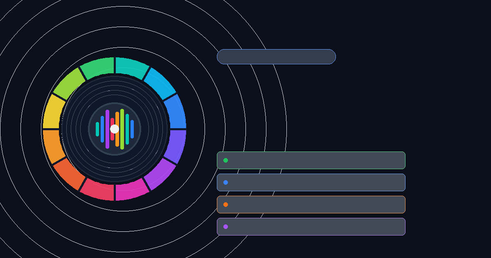

# Camelot BPM Studio 🎧

> **Free In-Browser Camelot Key & BPM Finder for DJs & Music Producers**  
> 100% Client-Side Web Audio API · Zero Server Uploads · Instant Batch Crate Prep



---

## ⚡ Features

- **🔒 100% Client-Side Privacy (Zero Server Uploads)**:  
  Audio decoding, transient analysis, and harmonic key matching run strictly inside your browser's Web Audio sandbox. Unreleased demos, VIPs, and client stems never touch a cloud server.
- **🎯 Camelot Wheel Notation (8A, 8B, 11B)**:  
  Detects musical key and maps directly to the standard 24-position Camelot harmonic mixing wheel.
- **⚡ Decimal-Precision BPM Detection**:  
  Calculates exact tempos for electronic dance music, hip-hop, dubstep, and drum & bass.
- **🔄 Instant Half / Double Tempo Toggle (×2 / ÷2)**:  
  Eliminates half-time confusion in Trap (140 vs 70 BPM) and Drum & Bass (174 vs 87 BPM) with 1 click.
- **📁 Multi-Track & Folder Batch Ingestion**:  
  Drop up to 20 tracks at once completely free without an account.
- **📊 1-Click CSV Crate Export**:  
  Download a structured CSV spreadsheet of your track keys, BPMs, and compatible harmonic mix transitions.
- **🏷️ Pro In-Browser ID3 Tag Writing**:  
  Embeds `TKEY` (Camelot Key) and `TBPM` directly into MP3 files so Pioneer Rekordbox, Serato DJ Pro, Traktor, and Engine DJ read them automatically.

---

## 🗺️ GEO & Sub-Page Matrix

- `/` — **Main Tool Landing**: Batch drag-and-drop audio analyzer, comparative benchmarks, and comprehensive FAQ.
- `/camelot-key-finder` — **Harmonic Mixing Guide**: Interactive Camelot wheel, transition matrix (+1/-1, relative, energy boost), and mixing rules.
- `/batch-bpm-finder` — **Multi-Track Crate Prep**: Bulk folder drop, decimal precision tempo detection, and CSV export.
- `/offline-audio-analyzer` — **Zero-Upload Privacy Focus**: Technical breakdown of browser RAM decoding for unreleased music.
- `/tempo-half-double-fix` — **Half/Double Tempo Resolver**: Scientific explanation of kick/snare half-time feel and 1-click multipliers.

---

## 🛠️ Tech Stack

- **Framework**: Next.js 16 (Turbopack, App Router)
- **Styling**: Tailwind CSS v4, Lucide Icons
- **Audio Engine**: HTML5 Web Audio API (`AudioContext`, `OfflineAudioContext`, Chromagram FFT, Peak Autocorrelation)
- **ID3 Tagging**: `browser-id3-writer` (pure client-side ID3v2.3 frame writer)
- **Authentication**: Better Auth (Google OAuth 2.0 single sign-on)
- **Internationalization**: `next-intl` (English & Chinese)
- **Payments**: Stripe & Creem webhooks

---

## 🚀 Getting Started

```bash
# Install dependencies
pnpm install

# Start local dev server
pnpm dev

# Build for production
pnpm build
```

---

## 📄 License

Proprietary / MIT.
